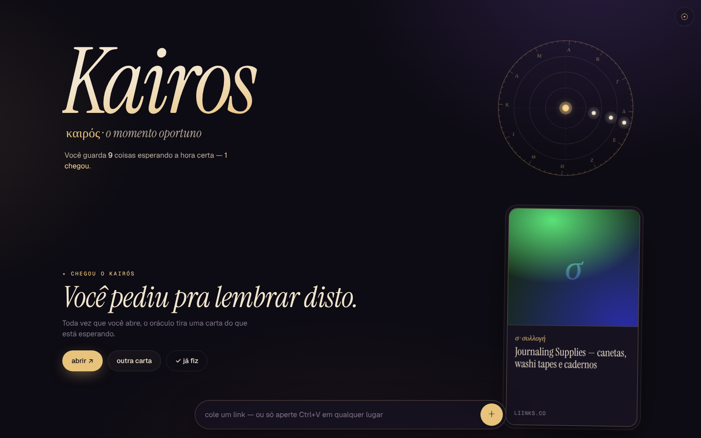
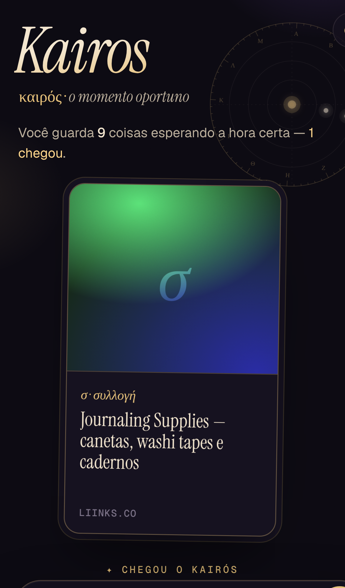

# Kairos · καιρός

> *Chronos* é o tempo que passa. *Kairos* é o momento certo.
> Um lugar pra guardar links — compras, leituras, vídeos, coleções — e recebê-los de volta na hora oportuna.

<p align="center"> </p>

## O que faz

| | |
|---|---|
| **Guardar sem atrito** | Ctrl+V em qualquer lugar da tela · arrastar o link pra janela · botão **+** lê a área de transferência · no Android aparece no menu *Compartilhar* · favorito (bookmarklet) no desktop |
| **Ver sem abrir** | Busca a thumbnail, título, descrição, site e preço (Open Graph). Sem imagem? Gera uma arte única a partir do domínio. |
| **Classifica sozinho** | Cada categoria tem um sigilo grego: **χ** χρῆμα (desejos/compras) · **λ** λόγος (leituras) · **θ** θέα (vídeos) · **σ** συλλογή (coleções tipo liinks.co) · **ξ** ξένος (outros) |
| **Me lembre** | hoje à noite, amanhã, 2 dias, fim de semana, 1 semana, 1 mês ou data livre. Notificação no app + **.ics** pro calendário nativo (toca mesmo com o app fechado). |
| **O oráculo** | Toda vez que você abre, uma carta vira com algo diferente esperando por você. Lembretes vencidos têm prioridade; links mais antigos têm mais chance. |
| **O astrolábio** | Cada lembrete é um astro. Quanto mais perto do centro, mais perto da hora. |

## Rodar

```bash
npm install
npm run dev        # http://localhost:5173 (também acessível pelo celular na mesma rede)
npm run build
```

**Publicar:** importe o repositório na Vercel — ela detecta o Vite e transforma `api/preview.ts` em função serverless automaticamente. Depois, no celular, abra o site e "Adicionar à tela inicial".

## Decisões

- **PWA, não app nativo.** Um código só pra celular e desktop, instalável, funciona offline, entra no menu de compartilhar do Android.
- **Local-first (IndexedDB).** Abre instantâneo, sem login, sem servidor de dados. Exportar/importar JSON leva os dados entre aparelhos.
- **Prévia no servidor** (`server/preview.ts`), porque o navegador não pode ler HTML de outros sites (CORS). Cai pro Microlink se falhar; YouTube usa a thumbnail direta.
- **Lembrete em duas camadas.** Notificação web funciona com o app aberto/em segundo plano; o `.ics` garante o alarme do sistema. Push com o app fechado de verdade exige backend — fica pro próximo passo.

## Próximos passos

1. **Sincronização entre aparelhos** (Supabase ou similar: login por link mágico + push real).
2. Extensão de navegador / atalho do iOS pra compartilhar no iPhone.
3. Coleções manuais ("presentes pra mãe", "setup do escritório").

## Estrutura

```
server/preview.ts   extrai metadados de uma URL (usado no dev e na Vercel)
api/preview.ts      função serverless GET /api/preview?url=
src/model.ts        tipos, categorias, banco local, lembretes, .ics, prévia
src/App.tsx         interface: astrolábio, oráculo, mural, painel, barra
src/styles.css      todo o visual
```
