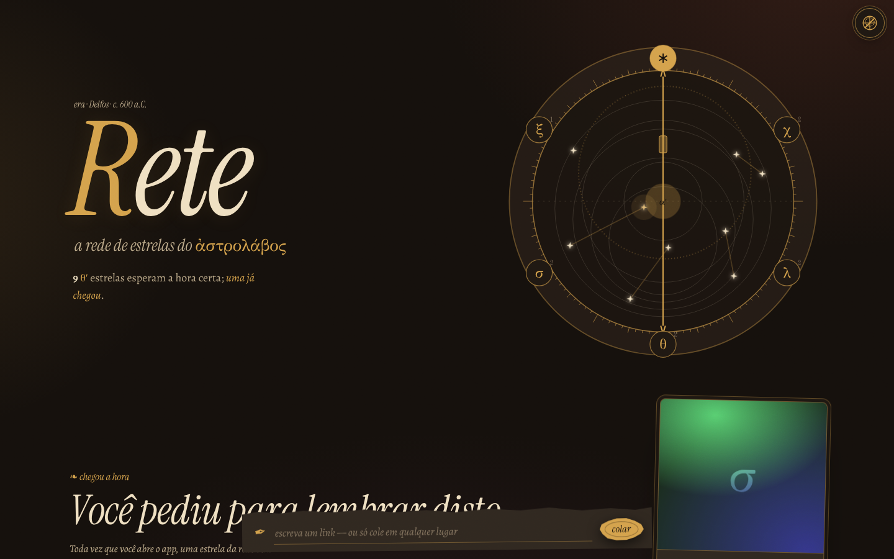
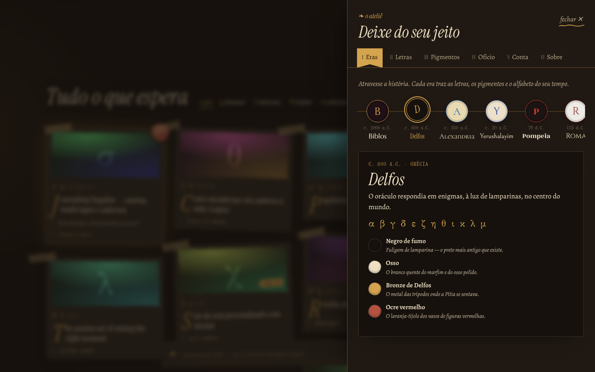
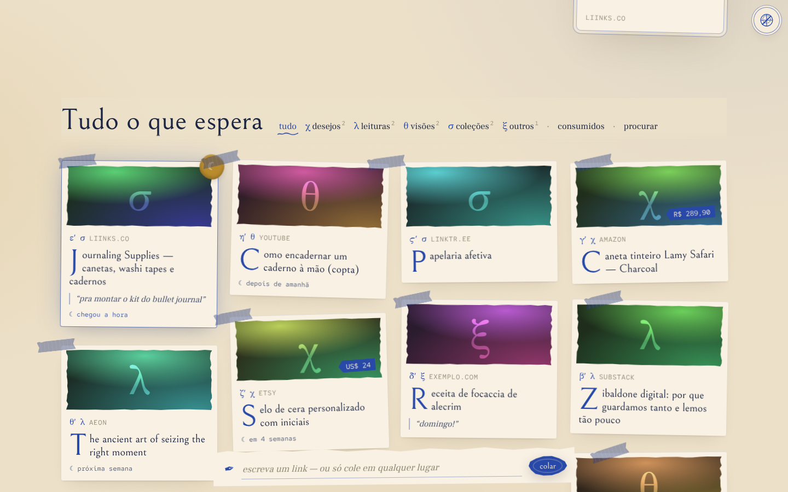

# Rete

> *rēte*, latim: “rede”. No astrolábio, a **rete** é a placa vazada que guarda o mapa das estrelas e gira sobre o céu.
> Aqui ela guarda os seus links — compras, leituras, vídeos, coleções — e gira até trazer cada um de volta na hora certa.

<p align="center"> </p>
<p align="center"> </p>

## O que tem

- **App de verdade** para Windows, macOS, Linux e Android (Tauri). Nada de PWA.
- **Lembretes que tocam de verdade.** No celular, o próprio sistema agenda o alarme — toca com o app fechado. No computador, o Rete abre junto com o sistema e fica na bandeja.
- **O astrolábio é a navegação.** As cinco categorias ficam no anel (χ desejos · λ leituras · θ visões · σ coleções · ξ outros); cada link é uma estrela; cada categoria, uma constelação. Quanto mais perto do centro, mais perto da hora.
- **O feitiço.** As letras surgem girando em órbita, trocando de alfabeto, e pousam formando a palavra. O alfabeto muda com a era: grego, fenício, hebraico, aramaico, árabe, latim.
- **16 eras numa linha do tempo**, de Biblos (c. 1000 a.C., onde nasceu o alfabeto) ao Abismo — cada uma com fontes, alfabeto e **pigmentos históricos com nome e história** (cinábrio de Pompeia, azul egípcio, púrpura de Tiro, vermelhão das rubricas, latão de astrolábio…).
- **75 fontes** escolhidas por papel (títulos, texto, rótulos, grego, feitiço), com selo de quem escreve grego (Ελ) e hebraico (עב), e qualquer outra do Google Fonts pelo nome.
- **Sem cara de formulário.** Ações são lacres; links têm sublinhado de pena; escolhas são frases (“Isto é *uma leitura*. Me lembre *amanhã*.”); os itens são recortes colados com fita, numerados em numerais gregos (αʹ βʹ γʹ…) com letra capitular.
- **Guardar sem esforço:** copie um link em qualquer app e volte ao Rete — ele oferece guardar. Ou cole (Ctrl+V), arraste, ou use o marcador do navegador (`rete://add`).
- **Prévia sem abrir:** o app busca título, imagem e preço direto do site.
- **Sincronização** celular ↔ computador (Supabase, login Google ou e-mail).
- **Atualiza sozinho** e mostra o que mudou.

## Baixar

Cada versão aparece em [Releases](../../releases) com os instaladores:
`.msi`/`.exe` (Windows) · `.dmg` (macOS) · `.deb`/`.AppImage`/`.rpm` (Linux) · `_android.apk` (Android, quase todos os celulares) e `_android-armv7.apk` (celulares antigos, de 32 bits).

> Os instaladores ainda não têm certificado de editor: o Windows mostra o aviso do SmartScreen (“Mais informações → Executar assim mesmo”) e o macOS pede clique-direito → Abrir na primeira vez.

## Desenvolver

```bash
npm install
npm run dev          # app nativo com recarga ao vivo (precisa de Rust)
npm run dev:web      # só a interface, no navegador
npm test
npm run build        # instaladores para o seu sistema
```

Linux precisa de: `libwebkit2gtk-4.1-dev libgtk-3-dev libayatana-appindicator3-dev librsvg2-dev libxdo-dev`.

## Versões e releases (automático)

Mensagens de commit em [Conventional Commits](https://www.conventionalcommits.org/pt-br) — o hook local recusa as que fogem do padrão:

| commit | versão |
|---|---|
| `fix: ...` | 0.2.**1** |
| `feat: ...` | 0.**3**.0 |
| `feat!: ...` / `BREAKING CHANGE:` | **1**.0.0 |

A cada push na `main`, o **semantic-release** decide a versão, atualiza `CHANGELOG.md`, cria a tag e a Release; em seguida o GitHub Actions compila os instaladores de todas as plataformas e anexa à Release.

### Uma vez só: ligar o atualizador automático

O app instalado só aceita atualizações assinadas. Adicione em **Settings → Secrets and variables → Actions**:

- `TAURI_SIGNING_PRIVATE_KEY` — o conteúdo da chave privada (a pública já está em `src-tauri/tauri.conf.json`)
- `TAURI_SIGNING_PRIVATE_KEY_PASSWORD` — vazio (a chave foi gerada sem senha)

### Uma vez só: chave fixa do Android

Sem ela, cada APK sai com uma assinatura diferente e o Android pede para desinstalar antes de atualizar. Gere e cadastre:

```bash
keytool -genkeypair -keystore rete.keystore -alias rete -keyalg RSA -keysize 2048 -validity 10000 -dname "CN=Rete"
base64 -w0 rete.keystore   # → secret ANDROID_KEYSTORE_BASE64
```
e a senha escolhida no secret `ANDROID_KEYSTORE_PASSWORD`. Guarde o `rete.keystore` num lugar seguro: perder a chave = reinstalar o app.

Se perder a chave do atualizador: `npx tauri signer generate -w rete.key`, troque o `pubkey` em `src-tauri/tauri.conf.json` pelo conteúdo de `rete.key.pub` e salve a nova privada no secret.

## Sincronização (Supabase)

1. Crie um projeto em [supabase.com](https://supabase.com) e rode [`supabase/migrations/0001_init.sql`](supabase/migrations/0001_init.sql) no SQL Editor.
2. Em **Authentication → URL Configuration → Redirect URLs**, adicione `rete://auth` (o login volta para o app por esse link).
3. **Login com Google:** crie um *OAuth client* no Google Cloud com redirect `https://SEU-PROJETO.supabase.co/auth/v1/callback` e cole em **Authentication → Providers → Google**.
4. Crie os secrets `VITE_SUPABASE_URL` e `VITE_SUPABASE_ANON_KEY` no GitHub (e num `.env.local` para desenvolver). A chave *anon* é pública por design: quem protege os dados é a segurança por usuário (RLS) do SQL.

## Estrutura

```
src-tauri/          casca nativa (Rust): bandeja, iniciar com o sistema, plugins, ícones
src/native.ts       ponte com o sistema: notificações, prévia, área de transferência, links rete://
src/spell.tsx       o feitiço das letras + numerais gregos
src/prefs.ts        eras, pigmentos, alfabetos, preferências
src/fonts.ts        catálogo de 75 fontes (verificadas no Google Fonts)
src/App.tsx         astrolábio, oráculo, mural, pena, ficha
src/Atelier.tsx     ateliê: eras, letras, pigmentos, ofício, conta, sobre
src/sync.ts         sincronização (Supabase)
src/update.ts       atualizador + diário de bordo
server/preview.ts   leitor de metadados (Open Graph)
```
