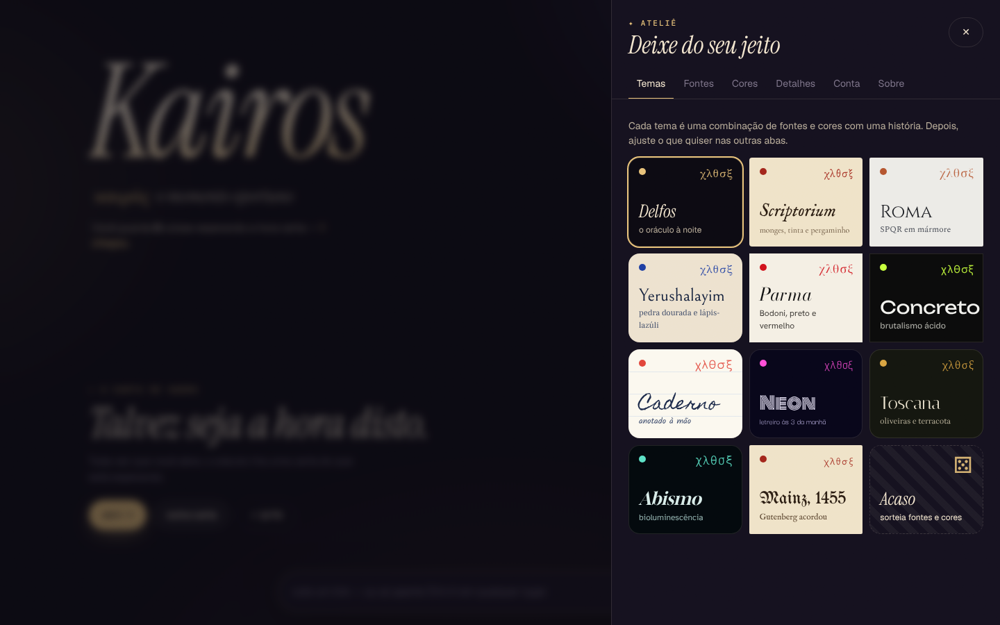
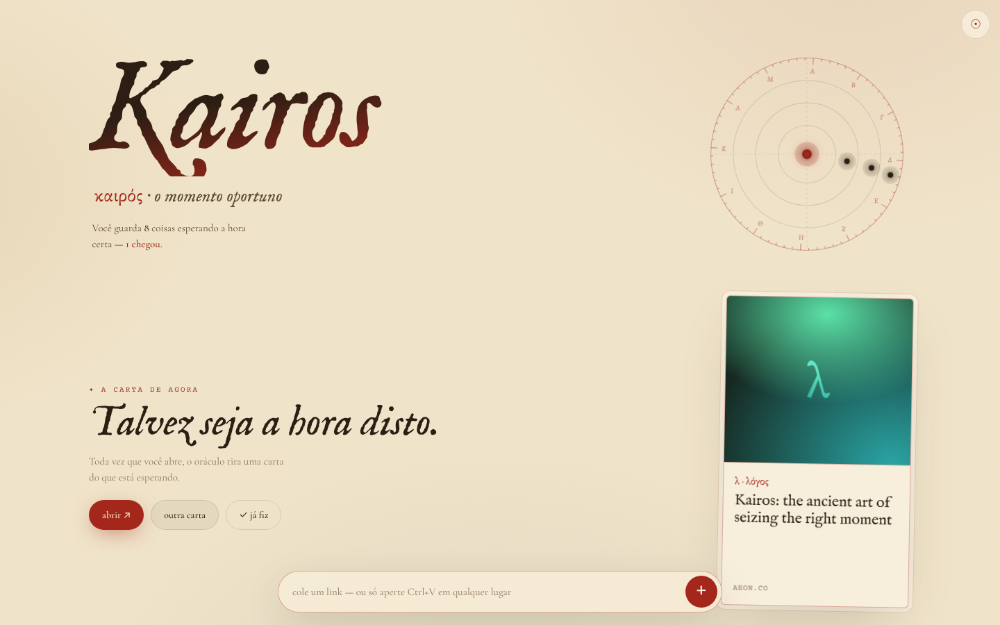
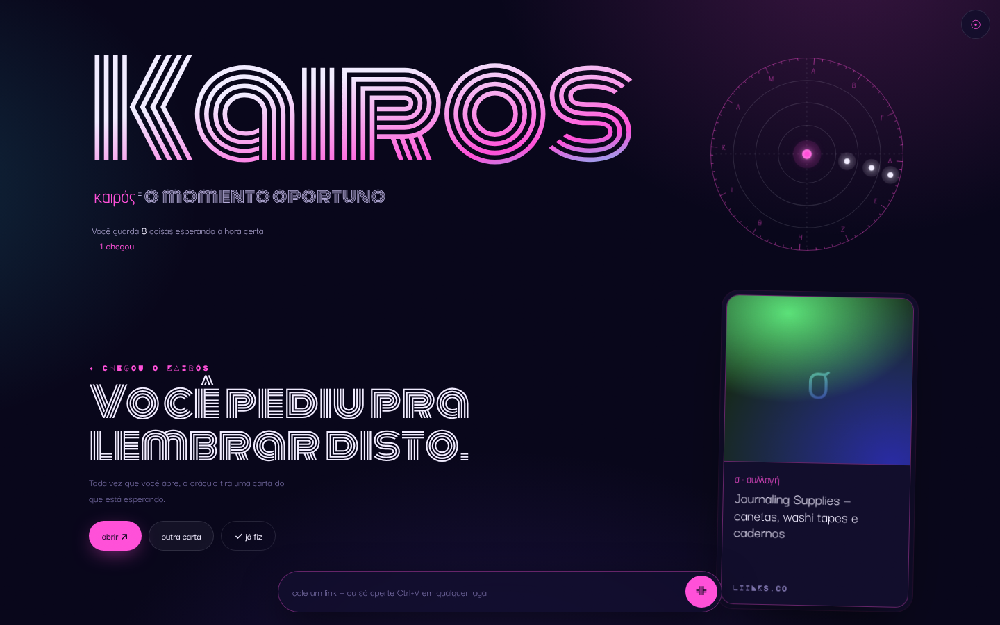

# Kairos · καιρός

> *Chronos* é o tempo que passa. *Kairos* é o momento certo.
> Guarde links — compras, leituras, vídeos, coleções — e receba cada um de volta na hora oportuna.

<p align="center"> </p>
<p align="center"> </p>

## O que faz

| | |
|---|---|
| **Guardar sem atrito** | Ctrl+V em qualquer lugar · arrastar o link pra janela · botão **+** · menu *Compartilhar* do Android · favorito no desktop |
| **Ver sem abrir** | Thumbnail, título, descrição, site e preço (Open Graph). Sem imagem, gera uma arte do domínio. |
| **Sigilos gregos** | **χ** χρῆμα (desejos) · **λ** λόγος (leituras) · **θ** θέα (vídeos) · **σ** συλλογή (coleções) · **ξ** ξένος (outros) |
| **Me lembre** | hoje à noite · amanhã · 2 dias · fim de semana · 1 semana · 1 mês · data livre — notificação + `.ics` pro calendário |
| **Oráculo** | Uma carta diferente a cada abertura. Lembretes vencidos primeiro; os mais antigos têm mais chance. |
| **Astrolábio** | Cada lembrete é um astro: quanto mais perto do centro, mais perto da hora. |
| **Ateliê** | 11 temas, 61 fontes em 4 papéis, 10 paletas, cor livre, qualquer fonte do Google Fonts pelo nome, densidade, inclinação, cantos, tamanho, animações, nome do app. |
| **Sincronização** | Entre com Google (ou link por e-mail) e tudo — links, lembretes e aparência — fica igual no celular e no computador. |
| **Atualiza sozinho** | Versão nova baixa em silêncio, troca quando você não está olhando e mostra as novidades. |

## Rodar

```bash
npm install
cp .env.example .env.local   # opcional: só para a sincronização
npm run dev                  # http://localhost:5173
npm test
npm run build
```

Sem `.env.local`, o app funciona 100% local (IndexedDB), só sem sincronizar.

## Sincronização (Supabase)

**Por que Supabase e não Firebase/Google Drive:** Postgres de verdade, login com Google pronto, tempo real, plano grátis generoso, código aberto (dá pra sair quando quiser) e — o motivo decisivo — agenda tarefas no servidor (`pg_cron` + Edge Functions) de graça, que é o caminho para o lembrete chegar com o app fechado. No Firebase isso exige plano pago.

**Como funciona:** *local-first*. Tudo é salvo primeiro no aparelho; a nuvem só reconcilia. Conflito entre aparelhos: vence a edição mais recente (o servidor também ignora escritas antigas). Apagar vira "lápide" para propagar. Mudanças chegam nos outros aparelhos em tempo real.

**Configurar (uma vez, ~10 min):**

1. Crie um projeto em [supabase.com](https://supabase.com).
2. **SQL Editor** → cole e rode [`supabase/migrations/0001_init.sql`](supabase/migrations/0001_init.sql).
3. **Project Settings → API**: copie *Project URL* e a chave *anon* para `.env.local` (e nas variáveis de ambiente da Vercel).
4. **Authentication → URL Configuration**: em *Site URL* e *Redirect URLs*, coloque o endereço do app (ex.: `https://kairos.vercel.app`) e `http://localhost:5173`.
5. **Login com Google:** no [Google Cloud Console](https://console.cloud.google.com/apis/credentials) crie um *OAuth client ID* (Web), com *Authorized redirect URI* = `https://SEU-PROJETO.supabase.co/auth/v1/callback`. Cole o Client ID e o Secret em **Authentication → Providers → Google**.
6. O login por e-mail (link mágico) já vem ligado.

## Versões, commits e releases

Versionamento semântico automático a partir das mensagens de commit ([Conventional Commits](https://www.conventionalcommits.org/pt-br)):

| commit | exemplo | versão |
|---|---|---|
| `fix:` | `fix(preview): thumbnail do Instagram` | 0.2.**1** |
| `feat:` | `feat(atelier): fontes hebraicas` | 0.**3**.0 |
| `feat!:` ou `BREAKING CHANGE:` | `feat!: novo formato de dados` | **1**.0.0 |
| `docs:` `chore:` `refactor:` `test:` `ci:` | — | não gera versão |

- **Hook local** (`.githooks/commit-msg`, ativado no `npm install`) recusa mensagens fora do padrão.
- **CI** roda testes e build em todo PR e push na `main`; o título do PR também é validado.
- **release-please** mantém um PR de release com a próxima versão e o `CHANGELOG.md`. Merge nele → tag `vX.Y.Z` + Release no GitHub.
- **Vercel** publica a `main` → o app instalado se atualiza sozinho e mostra as notas da versão (lidas do `CHANGELOG.md`).

## Publicar

Importe o repositório na Vercel (detecta Vite; `api/preview.ts` vira função serverless). Defina `VITE_SUPABASE_URL` e `VITE_SUPABASE_ANON_KEY`. No celular: abrir o site → "Adicionar à tela inicial".

## Estrutura

```
server/preview.ts        extrai metadados de uma URL (dev e Vercel)
api/preview.ts           função serverless GET /api/preview?url=
src/model.ts             tipos, categorias, banco local, lembretes, .ics, prévia
src/sync.ts · merge.ts   sincronização Supabase (login, puxa/empurra, tempo real)
src/update.ts            atualização automática + notas da versão
src/fonts.ts             catálogo tipográfico (61 fontes verificadas, suporte a grego/hebraico)
src/prefs.ts             paletas, temas, preferências
src/Atelier.tsx          painel de personalização
src/App.tsx              astrolábio, oráculo, mural, painel do item, barra
supabase/migrations/     esquema do banco + segurança por usuário (RLS)
tests/                   node --test
```

## Próximos passos

1. Lembrete com o app **fechado** via Web Push (Supabase Edge Function + `pg_cron`).
2. Atalho do iOS para compartilhar no iPhone.
3. Coleções manuais ("presentes", "setup do escritório").
